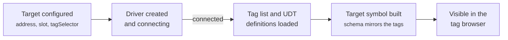

# 1. Targets, Symbols & Mapping

[Overview](README.md) · Next: [Reading & Writing →](02-reading-and-writing.md)

Before a control can show a PLC value, three things must exist: a connected driver for the controller, a target symbol that describes the controller's tags, and a mapped symbol for the part of those tags the control binds to.

---

## From configuration to a target symbol

Each entry under `Targets` in the extension's configuration becomes one driver:

| Setting | Meaning |
|---------|---------|
| `targetAddress` | IP address of the controller or of the communication module |
| `targetSlot` | Route to the CPU, e.g. `1,0` |
| `timeout` | Per-operation timeout in ms (default 1000) |
| `maxConcurrentOperations` | How many PLC operations the driver runs at once for this target (default 8) |
| `tagSelector` | Which tags to expose. Empty means all of them. |

The driver connects in the background. Once it's connected, the extension asks it for the controller's tag list and the definitions of the UDTs those tags use, and builds the **target symbols** from them.

### Choosing which tags appear

Large programs can have thousands of tags. `tagSelector` limits what's loaded and shown, which keeps the browser manageable and startup fast:

| Entry | Exposes |
|-------|---------|
| `Counter` | the controller tag `Counter` |
| `Program:Main` | every tag in the program `Program:Main` |
| `Program:Main.Recipe` | only the tag `Recipe` in `Program:Main` |

### What the target symbol looks like

The target symbol's type is a JSON schema generated from the controller:

- primitives (`DINT`, `REAL`, `BOOL`, …) map to the HMI's standard types, and every string type maps to `String`;
- each UDT becomes a named type with one property per member, defined once and shared by every tag that uses it;
- arrays become fixed-length arrays (multi-dimensional arrays nest);
- programs become containers whose tags you can browse.

UDT type names are prefixed with the target name, so two controllers can use different UDTs with the same name.

Some nodes can be browsed but not mapped: the target itself, and whole programs. Map individual tags or members inside them.

## Mapping

Mapping a node in the tag browser creates a **mapped symbol** in the server's configuration. Conceptually it records:

| Part | Example | Purpose |
|------|---------|---------|
| Name | `TcHmiLogixDriver.PLC1.Line.Motors.0` | What controls bind to |
| Domain | `TcHmiLogixDriver` | Which extension serves it |
| Mapping | `PLC1::Line::Motors[0]` | The path inside the target symbol |
| Type | `MOTOR_UDT` | Used by the designer, and to validate written values |

The extension uses mapped symbols for two things. Requests arrive carrying the symbol's *mapping*, and that's how the extension knows which tag is being asked for. The extension also keeps its own index of every symbol that's mapped for each target, built from the symbols' *names*. That index, the **mapping tree**, decides how much is read from the PLC ([page 2](02-reading-and-writing.md#choosing-what-to-read)).

> **Keep the default names.** The mapping tree is built from the names the tag browser assigns (`TcHmiLogixDriver.<target>.<path>`). Renaming a mapped symbol isn't supported: the symbol drops out of the tree, so bindings through it read a larger mapped parent, or fail.

## When the controller program changes

Changes to the PLC program (a new tag, or an edited UDT) may need the extension reloaded, and will require mapped symbols to be refreshed.

---

[Overview](README.md) · Next: [Reading & Writing →](02-reading-and-writing.md)
