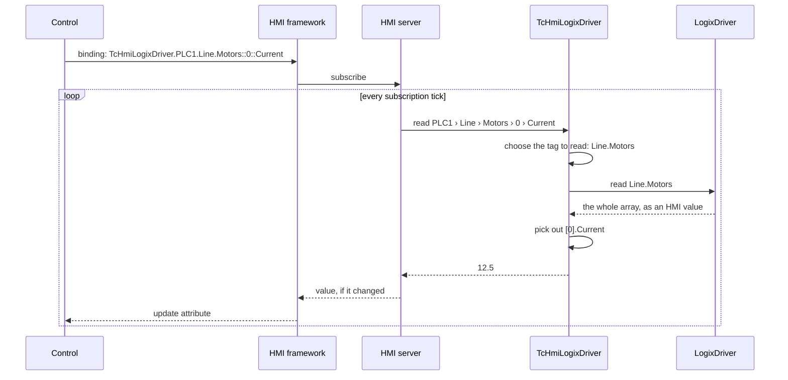

# 2. Reading & Writing

[← Targets, Symbols & Mapping](01-symbols-and-mapping.md) · [Overview](README.md) · Next: [Connections & Errors →](03-connections-and-errors.md)

The examples on this page use this PLC tag on target `PLC1`:

```
Line                 LINE_UDT
├── Speed            REAL
├── Running          BOOL
└── Motors           MOTOR_UDT[4]
    └── [0..3]
        ├── Speed    REAL
        ├── Current  REAL
        └── Faults   DINT
```

and these three mapped symbols:

```
TcHmiLogixDriver.PLC1.Line
TcHmiLogixDriver.PLC1.Line.Motors
TcHmiLogixDriver.PLC1.Line.Motors.2.Speed
```

---

## How a read travels



1. **Bind.** A control attribute references a mapped symbol, optionally followed by a sub-path. `…Line.Motors::0::Current` and `…Line.Motors[0]::Current` mean the same thing.
2. **Subscribe.** The framework groups the page's bindings into subscriptions and sends them to the server.
3. **Route.** On each tick, the server looks up the mapped symbol, checks access, and passes the request to the extension. The request carries the full path: the symbol's mapping plus the binding's sub-path, merged into one list of path elements.
4. **Choose what to read.** The extension uses its mapping tree to pick the tag to read ([below](#choosing-what-to-read)).
5. **Read.** The driver reads that tag and converts it into an HMI value.
6. **Narrow.** The extension picks the requested part out of that value and returns it.

The server then compares the result with the last one, and sends it to the client only if it changed.

## Choosing what to read

The request no longer says which mapped symbol it came through, only the full path. So the extension decides what to read with its mapping tree: a tree of every mapped path for the target, with each mapped path's last node marked.

```
Line                  ● mapped
└── Motors            ● mapped
    └── 2
        └── Speed     ● mapped
```

The rule is: **read the longest mapped path that the request starts with**. The PLC reads based on the mapping, and then the server resolves the rest of the requested path:

| Binding | Longest mapped prefix | Read from PLC | Resolved from PLC data |
|---------|-----------------------|---------------|----------------|
| `…PLC1.Line::Speed` | `Line` | `Line` (whole UDT) | `Speed` |
| `…PLC1.Line.Motors::0::Current` | `Line.Motors` | `Line.Motors` (whole array) | `[0].Current` |
| `…PLC1.Line.Motors::2::Current` | `Line.Motors` | `Line.Motors` (whole array) | `[2].Current` |
| `…PLC1.Line::Motors[2]::Speed` | `Line.Motors.2.Speed` | `Line.Motors[2].Speed` (one REAL) | nothing |

Two things to notice:

- **The most specific mapping wins, whichever symbol you bind through.** The last row binds through `Line`, but because `Line.Motors[2].Speed` has its own mapping, only that REAL is read.
- **Nodes that are only on the way to a deeper mapping don't count.** `Line.Motors[2]` isn't mapped, so `Line.Motors[2].Current` is served by the `Line.Motors` read, together with the other motors.

The extension keeps the tree in step with the server's mapped symbols. It's built whenever a target's symbol loads. In engineering it's refreshed while you work, and it's also refreshed when a request arrives that the tree doesn't cover.

## Shared reads

The driver joins concurrent reads of the same tag into one PLC transaction. Because every binding under a mapped parent reads the same tag, all of them polled in the same tick, from any number of clients, cost one read of that parent.

The cost of a page is therefore set by the **distinct tags its bindings resolve to**, not by the number of bindings.

## Tuning your mappings

| Situation | Map | Why |
|-----------|-----|-----|
| A page shows many members of one structure or array | the parent | one read serves them all |
| A page shows a few members of a large structure or array | each member | only those bytes are transferred |
| Most of a structure is shown, plus one member that's polled fast or needs to stay small | the parent **and** that member | the member gets its own small read, and everything else shares the parent read |
| Members spread across a large array, a few elements each | the elements (`Motors[2]`, `Motors[5]`) | each element is read on its own instead of the whole array |

A few practical limits:

- Every distinct tag read uses one of the target's concurrent operations (`maxConcurrentOperations`). Many small mappings polled at once can queue behind each other, and one large read can take longer than several small ones. Measure for your page.
- A read of a large UDT or array transfers the whole thing on every tick, even if one member is shown.
- Mapping changes only affect reads. Writes ignore mappings.

## Values

The driver converts PLC data directly into HMI values:

| PLC type | HMI value |
|----------|-----------|
| `BOOL` | boolean |
| `SINT`, `INT`, `DINT`, `LINT` and unsigned variants | integer of the matching size |
| `REAL`, `LREAL` | number |
| string types | string |
| UDT | object, keyed by member name |
| array | array (nested for multi-dimensional arrays) |

Other types can't be read or written, and requests for them fail with an error that names the type.

## How a write travels

A write takes the same route through the framework and the server: a two-way binding, a `WriteToSymbol` action, or a script. Inside the extension it's simpler: the **full requested path is the tag that's written**, regardless of mappings.

| Write to | Writes on the PLC |
|----------|-------------------|
| `…PLC1.Line::Speed` | `Line.Speed`, one REAL |
| `…PLC1.Line.Motors::2::Current` | `Line.Motors[2].Current`, one REAL |
| `…PLC1.Line.Motors::2` | `Line.Motors[2]`, one whole `MOTOR_UDT` |
| `…PLC1.Flags::37` (`BOOL[64]`) | bit 37 of `Flags`. The driver changes only that bit. |

Writing `Line::Speed` through the `Line` symbol writes 4 bytes, not the whole UDT.

### What a written value must contain

The server checks written values against the mapped symbol's type first, and the extension checks again:

- **Structures must be complete.** Every member must be present. The driver writes the whole structure, so a missing member would overwrite the PLC value with a stale one. To change one member, write to that member's path.
- **Arrays must have exactly the declared number of elements.**
- **Primitives must fit the type.** For example, 70000 isn't a valid `INT`.
- **Strings must fit the string type's capacity.**

### Ordering and confirmation

Writes go ahead of waiting reads in the driver, so a button press isn't stuck behind a page full of polls. Writes to the same tag that arrive at the same moment are combined into one transfer.

A successful write returns the value that was sent. It isn't read back: the PLC's actual value shows up on the next subscription tick.

---

[← Targets, Symbols & Mapping](01-symbols-and-mapping.md) · [Overview](README.md) · Next: [Connections & Errors →](03-connections-and-errors.md)
