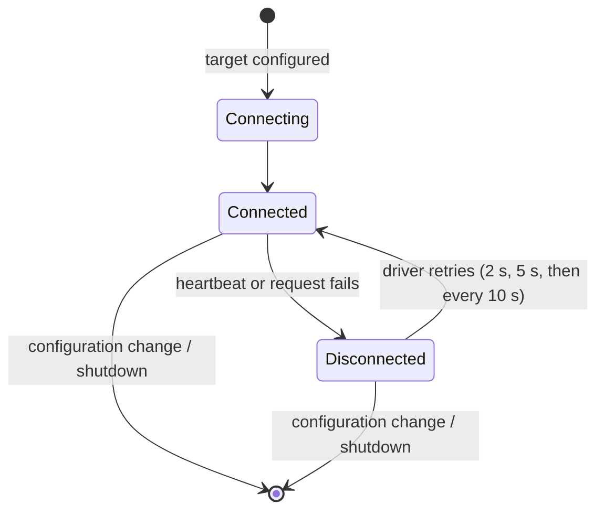

# 3. Connections & Errors

[← Reading & Writing](02-reading-and-writing.md) · [Overview](README.md)

---

## Connection monitoring



The driver owns the connection. It checks it with a heartbeat every 5 seconds, notices failed requests, and reconnects on its own with increasing back-off. The extension doesn't retry anything itself. It reacts to the driver's connection events:

- it updates the [diagnostics](#diagnostics) for the target;
- on (re)connection, it loads the target's tags and builds its symbol if needed ([page 1](01-symbols-and-mapping.md#when-the-controller-program-changes)).

While a target is disconnected, reads and writes for it fail right away with *Driver PLC1 disconnected* or *No connection to target PLC1*, instead of waiting for a timeout. Once the driver reconnects, subscriptions recover on their next tick without any action on the client.

## Configuration changes

Changing anything under `Targets` replaces **every** driver, not just the one that was edited. All targets disconnect, reconnect and reload their tags. Until a target has reconnected, requests for it fail with *Unknown command*, because its symbol doesn't exist yet.

Changes are never dropped. If one arrives while the previous one is still being applied, it's applied straight after with the latest settings.

## Diagnostics

The extension has a read-only symbol, `TcHmiLogixDriver.Diagnostics`, with an entry per target:

```json
{ "Targets": { "PLC1": { "isConnected": true, "controllerInfo": "…" } } }
```

Bind to it like any other symbol, for example `%s%TcHmiLogixDriver.Diagnostics::Targets::PLC1::isConnected%/s%` to drive a connection indicator. It's answered from memory and never touches the PLC, so it's cheap to poll.

## How failures appear

When a request fails, the control's symbol shows as erroring, and the message appears in the browser console. Other bindings in the same request are unaffected.

| Situation | Message or behaviour |
|-----------|----------------------|
| Target not connected yet since startup or a configuration change | *Unknown command '…' not handled* |
| Target disconnected | *Driver PLC1 disconnected* (read) / *No connection to target PLC1* (write) |
| No mapped symbol covers the requested path, e.g. a renamed symbol | *Requested symbol path … not found in map tree* |
| Tag, member or index doesn't exist on the PLC | error from the driver |
| Controller refuses the request (e.g. privileges) | error from the controller |
| Written value has the wrong shape | rejected by the server's type check, or an error naming the missing member or wrong element count |
| Unsupported data type | *Type X can't be read/written* |

Problems that happen outside a request go to the server log instead, such as a target whose tags fail to load or a driver that can't be created. If a target never appears in the tag browser, look there first.

### Edge cases

- **A connection lost in the middle of a request** is reported differently from one that was already down. A read that's in flight when the connection drops can surface as a binding error in the framework, rather than as an erroring symbol. A write in that window can report success even though it may not have reached the PLC. The next tick shows the true PLC value, so for critical writes, check the value afterwards.
- **Match the case of member names.** Logix names aren't case-sensitive, and neither is the mapping tree, but picking a member out of a value that's been read may be. Write sub-paths with the case the tag browser shows.

## Limitations

- **Renaming mapped symbols isn't supported.** Keep the default name the tag browser assigns ([page 1](01-symbols-and-mapping.md#mapping)).
- **Polling only.** The extension doesn't push values. Every subscription tick costs a PLC read, so choose subscription intervals and mappings with that in mind ([tuning](02-reading-and-writing.md#tuning-your-mappings)).
- **Runtime doesn't follow PLC program changes automatically.** On a deployed runtime, tags and types are loaded once per driver, on its first connection. You will have to update mappings and redeploy the server when affected tags change.

---

[← Reading & Writing](02-reading-and-writing.md) · [Overview](README.md)
