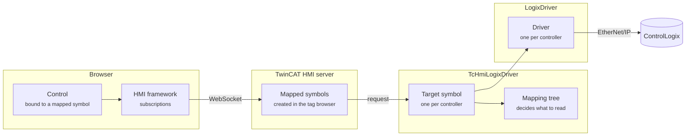

# TcHmiLogixDriver Overview

A conceptual guide to how TcHmiLogixDriver connects TwinCAT HMI controls to ControlLogix tags.

For installation, see the [repository README](../README.md).

| # | Page | Covers |
|---|------|--------|
| 1 | [Targets, Symbols & Mapping](01-symbols-and-mapping.md) | How a controller's tags become a browsable symbol, and what mapping a tag creates |
| 2 | [Reading & Writing](02-reading-and-writing.md) | How a binding becomes a PLC read or write, how mappings decide what's read, and how to tune them |
| 3 | [Connections & Errors](03-connections-and-errors.md) | Connection monitoring, configuration changes, diagnostics, how failures appear, and limitations |

---

## The big picture

Four layers each have their own job:

| Layer | Responsible for |
|-------|-----------------|
| **HMI framework** (browser) | Turning control bindings into subscriptions, and calling control attributes when values arrive |
| **HMI server** | Storing mapped symbols, checking access, polling the extension on every subscription tick, and sending clients only what changed |
| **TcHmiLogixDriver** (server extension) | Presenting each controller as a symbol, deciding which tag to read for each request, and converting between PLC data and HMI values |
| **[LogixDriver](https://github.com/bstiffler582/LogixDriver)** | Discovering tags and types, talking EtherNet/IP, sharing reads, prioritizing writes, and reconnecting |

## Key ideas

- **What you map decides what gets read.** A request is served by reading the most specific mapped tag that contains it, then picking the requested part out of the result. Mapping a parent structure means many bindings share one PLC read. Mapping a single member means only that member is transferred.
- **Writes go straight to the tag.** A write always targets exactly the path that was written, whatever the mappings are.
- **The extension is polled.** Clients ask for values on every subscription tick. The server will pool subscriptions of identical tags to multiple clients to optimize requests to the PLC.
- **The driver looks after the connection.** If the connection drops, requests fail quickly with a clear error until the driver reconnects on its own.

## Glossary

| Term | Meaning |
|------|---------|
| **Target** | One configured controller: its address, slot, timeout and which tags to expose. |
| **Domain** | The server's name for this extension, `TcHmiLogixDriver`. Every mapped symbol's name starts with it. |
| **Target symbols** | The symbols the extension creates for a target. Its types (JSON schema) mirror the controller's tags, UDTs and arrays. |
| **Mapped symbol** | A server symbol created by mapping a node in the tag browser. It points at a path inside a target symbol. Controls bind to these. |
| **Sub-path** | Anything a binding adds after the mapped symbol's name, such as `::Speed` or `[2]::Current`. |
| **Mapping tree** | The extension's index of which paths are mapped, per target. It's used to decide what each read pulls from the PLC. |
